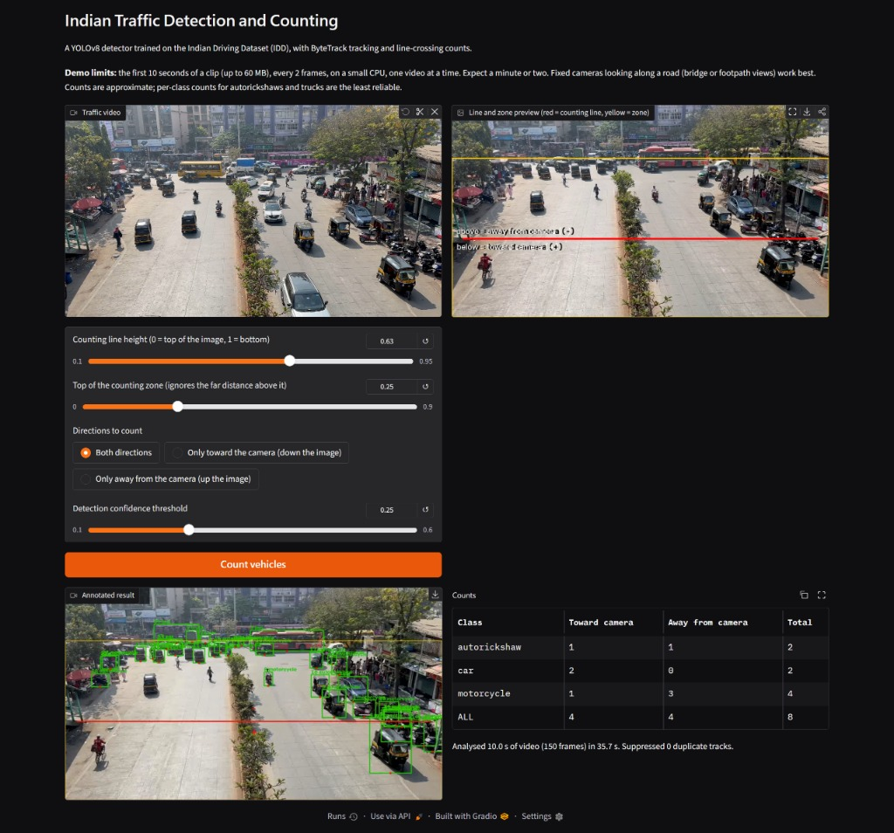
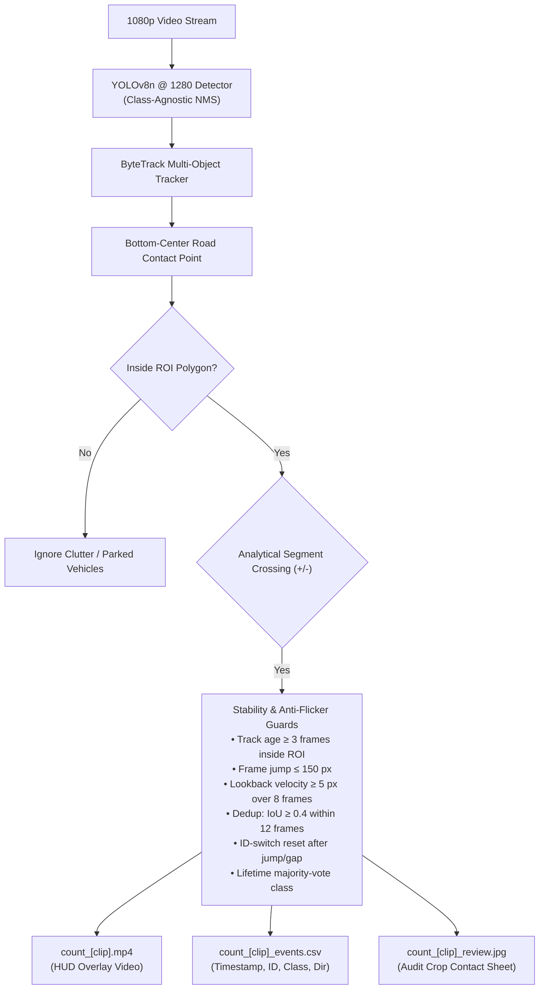

<div align="center">

# Indian Traffic Detection & Counting

**End-to-end computer vision pipeline for mixed Indian traffic: dataset curation, resolution-vs-capacity experiments, ByteTrack directional counting, Hungarian evaluation, and Dockerized FastAPI + Gradio deployment.**

`Python 3.10+` · `YOLOv8` · `ByteTrack` · `FastAPI` · `Gradio` · `Docker`

<br />



</div>

---

## At a Glance

| Metric / Capability | Result |
| :--- | :--- |
| **Selected Detector** | `YOLOv8n @ 1280` (`models/final.pt`) |
| **Validation Accuracy** | **0.443 mAP@50:95** (+9.8pp over `YOLOv8n @ 640` baseline) |
| **Out-of-Distribution (Shift) Accuracy** | **0.528 mAP@50:95** across side, rear, and far-view cameras |
| **Real-Time Throughput (1080p GPU)** | **~40 FPS end-to-end** (2× the 20 FPS real-time target) |
| **Directional Counting (7 clips, 154 events)** | **82% pooled recall** (127/154 matched via Hungarian evaluation) |
| **Deployment** | Containerized **FastAPI** async job API + **Gradio** web UI |

## Table of Contents

- [Problem & Dataset](#problem--dataset)
- [Model Exploration & Speed Benchmarks](#model-exploration--speed-benchmarks)
- [Tracking & Directional Counting Pipeline](#tracking--directional-counting-pipeline)
- [Counting Evaluation & Caveats](#counting-evaluation--caveats)
- [Docker Deployment & REST API](#docker-deployment--rest-api)
- [Local CLI Quickstart](#local-cli-quickstart)
- [Project Structure](#project-structure)

---

## Problem & Dataset

**Objective:** Detect, track, and directionally count road users across dense, heterogeneous Indian traffic conditions at **20+ FPS end-to-end** on 1080p video, optimized for **mAP@50:95**.

Built from [IDD Detection](http://idd.insaan.iiit.ac.in/) (41,794 images; 507,576 boxes across 15 classes), filtered to **7 road-user classes**:
`car` · `motorcycle` · `rider` · `autorickshaw` · `bus` · `truck` · `person`
*(Counting excludes `rider` and `person` to prevent double-counting two-wheelers.)*

| Split | Images | Boxes | Camera Views & Sampling |
| :--- | :---: | :---: | :--- |
| **train** | 6,082 | 95,911 | `highquality_16k` + `frontNear`, subsampled every 3rd frame |
| **val** | 5,138 | 67,298 | `highquality_16k` + `frontNear`, subsampled every 3rd frame |
| **shift** | 3,922 | 18,760 | `sideLeft`, `sideRight`, `rearNear`, `frontFar` (OOD viewpoints) |

> [!NOTE]
> **Dataset Limitation:** Dropping `vehicle fallback` (~21k boxes), `caravan`, and `trailer` left those vehicles unlabeled, effectively teaching models to treat them as background. Shift cameras also exhibit different object scale distributions than front-facing cameras.

---

## Model Exploration & Speed Benchmarks

### 1. Accuracy vs. Resolution & Model Capacity

Four training runs (plus test-time upscaling) were evaluated on identical `val` and `shift` splits:

| Run | Model | Config | `val` mAP@50:95 | `shift` mAP@50:95 | Inference | Key Takeaway |
| :--- | :--- | :--- | :---: | :---: | :---: | :--- |
| Baseline | YOLOv8n | 30 ep, 640 | 0.345 | 0.484 | 4.6 ms | Baseline detector |
| Test-time 1280 | YOLOv8n | 30 ep, test @ 1280 | 0.407 | 0.422 | 11.3 ms | No retrain; large vehicles degrade on shift |
| Run A | YOLOv8n | 80 ep, 640 | 0.354 | 0.488 | 4.6 ms | +0.9pp — proves 30 ep wasn't severely undertrained |
| Run C | YOLOv8s | 30 ep, 640 | 0.384 | 0.517 | 6.9 ms | +3.9pp — extra capacity reduces class confusion |
| **Run B (Selected)** | **YOLOv8n** | **30 ep, 1280** | **0.443** | **0.528** | **11.1 ms** | **+9.8pp `val` mAP; recovers tiny/distant objects** |

### 2. Why Resolution Won: Small-Object Recall (`val`, `conf=0.25`)

Tiny distant road users (~11×11 px at 640 vs. ~21×21 px at 1280) were the primary failure mode of the baseline detector. Training natively at 1280px dramatically improves small-object recall without degrading large vehicles.

| Object Area (% of frame) | Boxes in Val | Baseline (640) | Run B (1280) | Δ |
| :--- | :---: | :---: | :---: | :---: |
| `< 0.05%` | 22,385 | 7.3% | 25.3% | **+18.0pp** |
| `0.05 – 0.1%` | 8,905 | 30.9% | 56.9% | **+26.0pp** |
| `0.1 – 0.5%` | 18,093 | 59.2% | 73.2% | **+14.0pp** |
| `0.5 – 2.0%` | 9,608 | 82.4% | 86.7% | +4.3pp |
| `> 2.0%` | 8,309 | 93.6% | 94.2% | +0.6pp |

<details>
<summary><strong>View Per-Class mAP@50:95 Breakdown (val)</strong></summary>

| Class | Baseline (640) | Run A (ep80) | Run C (YOLOv8s) | **Run B (`imgsz=1280`)** | Δ vs Baseline |
| :--- | :---: | :---: | :---: | :---: | :---: |
| `car` | 0.399 | 0.408 | 0.437 | **0.502** | +10.3pp |
| `motorcycle` | 0.310 | 0.318 | 0.346 | **0.411** | +10.1pp |
| `rider` | 0.250 | 0.259 | 0.282 | **0.347** | +9.7pp |
| `autorickshaw` | 0.408 | 0.418 | 0.453 | **0.513** | +10.5pp |
| `bus` | 0.464 | 0.478 | 0.502 | **0.535** | +7.1pp |
| `truck` | 0.388 | 0.395 | 0.431 | **0.475** | +8.7pp |
| `person` | 0.197 | 0.204 | 0.236 | **0.320** | +12.3pp |
| **Overall** | **0.345** | **0.354** | **0.384** | **0.443** | **+9.8pp** |

Full quantitative breakdown and error gallery: [`results/failure_analysis.md`](results/failure_analysis.md).

</details>

### 3. 1080p End-to-End Speed Benchmark

Timed across 200 frames (`batch=1`, FP32 GPU, 1920×1080 — see `results/fps_benchmark_1080.csv`):

| Model | Clip | Model FPS | End-to-End FPS (incl. decode) | Detections / Frame |
| :--- | :--- | :---: | :---: | :---: |
| **YOLOv8n @ 1280** | `test4` | 44.6 | **38.7** | **28.8** |
| YOLOv8s @ 640 | `test4` | 52.3 | 44.7 | 14.6 |
| **YOLOv8n @ 1280** | `test24` (dense) | 46.9 | **40.7** | **137.2** |
| YOLOv8s @ 640 | `test24` (dense) | 53.6 | 45.9 | 73.2 |
| **YOLOv8n @ 1280** | `test6` | 46.0 | **40.1** | **54.6** |
| YOLOv8s @ 640 | `test6` | 52.6 | 44.6 | 37.3 |

**Why `YOLOv8n @ 1280` wins:** It hits **~40 FPS end-to-end** (doubling the 20 FPS target), beats `YOLOv8s @ 640` by **+5.9pp `val` mAP** and **+1.1pp `shift` mAP**, and recovers nearly **2× as many valid vehicles per frame** in dense scenes.

---

## Tracking & Directional Counting Pipeline

For fixed-camera traffic footage, the pipeline detects vehicles, tracks them across frames with ByteTrack, and counts each vehicle once upon crossing a user-calibrated line inside an ROI polygon. Counted vehicles highlight yellow in the HUD output.



### Core Pipeline Utilities
1. **Interactive Geometry Picker (`src/pick_geometry.py`):** Click two points to define the directional counting line (`+`/`-` normal) and 3+ points for the polygon ROI. Outputs JSON config and visual verification PNG.
2. **Traffic Counter (`src/count_traffic.py`):** Runs detection, ByteTrack, crossing verification, deduplication, and renders live HUD tallies. Supports `--only_dir` (`to_plus` / `to_minus`) as a per-scene operational setting for one-way roads.
3. **Audit Contact Sheet Generator:** Automatically crops each counted vehicle into a `_review.jpg` grid annotated with timestamp, track ID, and direction for rapid visual inspection.

---

## Counting Evaluation & Caveats

Line crossings are matched against reference crossing logs using the **Hungarian algorithm** (`src/eval_counts.py`), pairing events by movement direction and time proximity (`--tol 0.3` s) with a class-mismatch penalty.

| Evaluation Group | Clip | Window | Reference | Detected | Matched | Missed | Extra | Class Accuracy | Scene Notes |
| :--- | :--- | :---: | :---: | :---: | :---: | :---: | :---: | :---: | :--- |
| Tuned on | `test17` | 10–20s | 18 | 18 | 16 | 2 | 2 | 15/16 (94%) | Overhead view, northbound |
| Tuned on | `test4` | 5–15s | 20 | 15 | 15 | 5 | 0 | 15/15 (100%) | Mixed arterial road |
| Tuned on | `test10` | 10–20s | 22 | 18 | 17 | 5 | 1 | 17/17 (100%) | Highway flyover |
| Not tuned on | `test6` | 1–6s | 53 | 43 | 41 | 12 | 2 | 39/41 (95%) | High-volume two-way arterial |
| Not tuned on | `test24` | 2–7s | 8 | 5 | 5 | 3 | 0 | 5/5 (100%) | Standstill jam stress test |
| Fresh (blind) | `test16` | 1–9s | 12 | 13 | 12 | 0 | 1 | 12/12 (100%) | Logged before running counter |
| Fresh (blind) | `test25` | 10–20s | 21 | 31 | 21 | 0 | 10 | 20/21 (95%) | Logged before running counter |

**Pooled across all 7 windows:** **127 / 154 reference crossings matched (82%)**, with 16 extra detections (10 on `test25`).

> [!IMPORTANT]
> **How to Read These Numbers (Evaluation Limitations):**
> - **AI-generated reference logs:** Reference crossing logs were produced by an AI agent from raw videos rather than human annotators and were not independently verified. Treat metrics as indicative.
> - **Potential recall overstatement:** Heavily occluded vehicles (e.g., motorcycles tucked between cars) may be missing from the reference log itself.
> - **Tuned vs. Fresh split:** For the three *tuned on* clips, it was not recorded whether the logging agent saw counter outputs; their precision, class accuracy, and timing (median offset `0.03s` vs. `0.15s` on fresh clips) should not be read as independent evidence.
> - **`test25` extras:** All 10 extra detections occur in one direction and include autorickshaws, a motorcycle, and trucks, while the reference lists only cars—likely unlogged vehicles rather than true false positives (unverified).
> - **Sample size & stride:** Windows span 5–10s (154 total events; no confidence intervals). Evaluation ran at every frame (`STRIDE=1`), whereas the Docker demo defaults to `STRIDE=2` for CPU latency.

<details>
<summary><strong>Known Failure Modes & Counter Ablation (Frozen Setting: r3)</strong></summary>

### Known Failure Modes
- **Occluded two-wheelers:** Motorcycles riding between or behind larger vehicles miss detection entirely (~5 of 11 misses on `test4`, `test10`, `test17`). Lowering confidence adds false positives without recovering them.
- **Tailgating ID switches:** In tightly packed lanes, ByteTrack can transfer an active ID from a leading vehicle onto the trailing one, skipping the second crossing.
- **Late emergence:** Vehicles emerging from behind a truck immediately adjacent to the counting line lack the 3-frame track history required to trigger a count.
- **Standstill congestion (`test24`):** Micro-jitter on stationary boxes fragments tracks and induces spurious backward crossings.
- **Class ambiguity:** `car` and `motorcycle` counts are solid; `autorickshaw` and `truck` frequently confuse with box-bodied tempos, taxis, or rear-facing buses. Total counts are more reliable than per-class splits.

### Counter Ablation
| Variant | Setting | Effect |
| :--- | :--- | :--- |
| `r0` | `--no_reset --min_age 5` | Baseline |
| `r1` | `--no_reset --min_age 3` | `test6`: 3 fewer misses, 2 more extras |
| `r2` | `--min_age 5` (ID reset on) | Within noise |
| **`r3` (Frozen)** | **`--min_age 3` (ID reset on)** | **Default in `src/count_traffic.py`** |

</details>

---

## Docker Deployment & REST API

The detector and asynchronous video counter are packaged as a containerized **FastAPI** service with an integrated **Gradio** interface.

### Build & Run

```bash
# Build image
docker build -t traffic-demo .

# Run on CPU (default)
docker run --rm -p 7860:7860 traffic-demo

# Example: override for longer clips & full frame rate
docker run --rm -p 7860:7860 \
  -e MAX_SECONDS=20 \
  -e STRIDE=1 \
  traffic-demo
```

Once running, open:
- **Gradio Web UI:** `localhost:7860/demo` (or `localhost:7860`)
- **Swagger / OpenAPI Docs:** `localhost:7860/docs`

### REST Endpoints

| Endpoint | Method | Description |
| :--- | :---: | :--- |
| `/health` | `GET` | Service health, compute device, model state, and active limits |
| `/detect` | `POST` | Single-frame detection (JPEG/PNG); returns boxes, labels, and confidences |
| `/count` | `POST` | Queues an asynchronous video counting job; returns `job_id` |
| `/jobs/{job_id}` | `GET` | Polls job status and returns directional count tallies |
| `/jobs/{job_id}/video` | `GET` | Streams/downloads the H.264 MP4 annotated output with HUD |
| `/jobs/{job_id}/events` | `GET` | Exports crossing events (timestamp, track ID, class, direction) as CSV |

### Programmatic Example (`cURL`)

```bash
# 1. Submit counting job (horizontal line at 50% height, ROI top at 25%)
curl -F "file=@clip.mp4" -F "line_y=0.5" -F "roi_top=0.25" localhost:7860/count

# 2. Poll job status & count summary
curl localhost:7860/jobs/<job_id>

# 3. Download annotated video once completed
curl -o output.mp4 localhost:7860/jobs/<job_id>/video
```

### Environment Variables

| Variable | Default | Description |
| :--- | :---: | :--- |
| `DEVICE` | `cpu` | PyTorch device (`cpu` or `0` for CUDA GPU) |
| `IMGSZ` | `1280` | Inference resolution |
| `STRIDE` | `2` | Frame stride (processes every *N*th frame for CPU efficiency) |
| `MAX_SECONDS` | `10` | Max clip duration analyzed per job |
| `MAX_UPLOAD_MB` | `60` | Max upload file size |

---

## Local CLI Quickstart

```bash
# 1. Environment setup
python -m venv .venv
.venv\Scripts\activate          # Windows (Linux/macOS: source .venv/bin/activate)
pip install -r requirements.txt

# 2. Calibrate counting line & ROI polygon on a video
python src/pick_geometry.py --video path/to/video.mp4 --frame 300 --out configs/geometry_myvideo.json

# 3. Run tracking & directional vehicle counting
python src/count_traffic.py \
  --video path/to/video.mp4 \
  --weights models/final.pt \
  --geometry configs/geometry_myvideo.json \
  --imgsz 1280 \
  --conf 0.25

# 4. Evaluate against reference counts (or batch-run all clips)
python src/eval_counts.py \
  --events results/count_test17_v2_events.csv \
  --manual data/manual_test17.csv \
  --window 10 20 \
  --tol 0.3

python src/run_all_counts.py v3
```

---

## Project Structure

<details>
<summary><strong>Expand Repository Tree</strong></summary>

```text
indian-traffic-detection/
├── app/
│   ├── main.py                 # FastAPI REST API endpoints (/detect, /count, /jobs)
│   ├── services.py             # Async job runner, video clipping, background worker
│   └── ui.py                   # Gradio web interface components
├── assets/
│   └── demo.jpg                # Web UI demo screenshot
├── configs/
│   ├── idd.yaml                # IDD dataset train/val config
│   ├── idd_shift.yaml          # OOD shift evaluation config
│   └── geometry_test*.{json,png}
├── models/
│   └── final.pt                # Selected YOLOv8n @ 1280 weights
├── notebooks/
│   └── 01_eda.ipynb            # Exploratory data analysis
├── results/
│   ├── failure_analysis.md     # Quantitative failure analysis & gallery
│   ├── fps_benchmark_1080.csv  # 1080p real-time latency benchmark
│   ├── *.json / *.parquet      # Metrics & GT match tables
│   └── count_*                 # Annotated MP4s, event CSVs, audit contact sheets
├── src/
│   ├── count_traffic.py        # Tracking & directional counting pipeline
│   ├── pick_geometry.py        # Interactive OpenCV line & ROI picker
│   ├── eval_counts.py          # Hungarian matching evaluation
│   ├── evaluate.py             # YOLO validation mAP runner
│   ├── error_analysis.py       # GT match tables & recall by bin/class
│   ├── benchmark_all.py        # Multi-clip/model latency harness
│   ├── benchmark_fps.py        # Single-run FPS timer
│   ├── track_video.py          # Basic ByteTrack visualizer
│   └── video_info.py           # Video metadata probe & contact sheet builder
├── Dockerfile
├── requirements.txt            # Core CV pipeline dependencies
└── requirements-api.txt        # FastAPI + Gradio service dependencies
```

</details>
